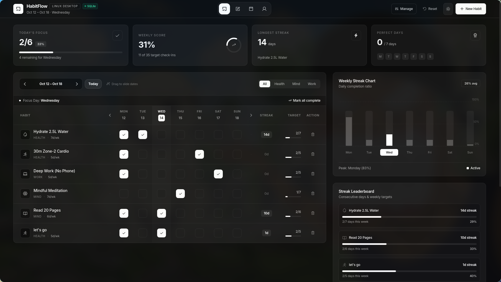

<div align="center">

  

  <h1>HabitFlow</h1>

  <p><b>The Minimal Monochrome Habit & Streak Dashboard for Linux</b></p>

  <p>
    <a href="#quick-installation"></a>
    <a href="#tech-stack"></a>
    <a href="#database-architecture"></a>
    <a href="#tech-stack"></a>
    <a href="LICENSE"></a>
    <a href="#contributing"></a>
  </p>

</div>

---

## ⚡ Overview

**HabitFlow** is an ultra-lightweight, distraction-free desktop application designed for quiet consistency. Built natively for Linux with **Python 3**, **WebKitGTK 4.1**, **PyWebView**, and **SQLite 3**, it uses only **~50 MB of RAM** (10x lighter than typical Electron apps) while delivering a pixel-perfect monochrome aesthetic with real-time drag physics, full edge-to-edge widescreen layout, and date-accurate local persistence.

---

## 📸 Preview

<div align="center">
  
</div>

---

## ✨ Key Features

- **🚀 50 MB Ultra-Lightweight**: Uses your Linux system's native WebKitGTK 4.1 engine. Instant boot time, zero bloat, and minimal memory footprint.
- **↔️ Real-Time Mouse Drag Physics**: Smoothly slide across weeks by clicking and dragging horizontally with your mouse or trackpad. Includes flanking `<` and `>` arrow navigation.
- **🗄️ Persistent SQLite Database**: All habits, historical check-ins, and dark/light settings are permanently stored in `~/.local/share/habitflow/habitflow.db`. Streaks persist across system reboots.
- **📅 Date-Accurate History**: Navigate to past or future dates with exact completion fidelity. If a habit was not logged for a date, it accurately displays as unchecked.
- **🗑️ Complete Habit Deletion System**: Dedicated action buttons on every row with confirmation dialogs, plus a centralized **Manage Habits** modal for quick habit removal.
- **🖥️ Full-Bleed Desktop Canvas**: Tailored specifically for modern Linux desktop environments (Hyprland, Sway, GNOME, KDE Plasma). No empty margins or cramped containers.
- **🔒 100% Offline & Private**: Zero accounts, zero tracking, zero telemetries. Ships with bundled offline Tailwind CSS and Phosphor icon fonts.

---

## 🚀 Quick Installation

Run the one-line automated installer in your terminal:

```bash
curl -sSL https://raw.githubusercontent.com/jasmin1727/habitflow/main/install.sh | bash
```

Or from a local clone:

```bash
git clone https://github.com/jasmin1727/habitflow.git
cd habitflow
./install.sh
```

### What the installer does:
1. Displays the custom ASCII art banner.
2. Verifies Python 3 and system `WebKitGTK 4.1` dependencies.
3. Sets up an isolated virtual environment with `pywebview` and `bottle`.
4. Initializes the local SQLite database schema at `~/.local/share/habitflow/habitflow.db`.
5. Creates a native desktop shortcut in `~/.local/share/applications/habitflow.desktop`.
6. Generates a global CLI command at `~/.local/bin/habitflow`.

---

## 💻 Manual Setup

If you prefer to configure the environment manually:

```bash
# 1. Clone the repository
git clone https://github.com/jasmin1727/habitflow.git
cd habitflow

# 2. Create and activate a virtual environment
python3 -m venv --system-site-packages .venv
source .venv/bin/activate

# 3. Install Python dependencies
pip install pywebview bottle

# 4. Initialize database and run
python app.py
```

### Launch Shortcut
```bash
./run.sh
```

---

## 🗄️ Database Architecture

HabitFlow uses a zero-configuration SQLite database located at:
```bash
~/.local/share/habitflow/habitflow.db
```

### Schema Diagram

```
┌─────────────────────────────────┐       ┌─────────────────────────────────┐
│             habits              │       │           habit_logs            │
├─────────────────────────────────┤       ├─────────────────────────────────┤
│ id           TEXT PRIMARY KEY   │◀──────│ habit_id     TEXT FOREIGN KEY   │
│ name         TEXT NOT NULL      │  1:N  │ log_date     DATE NOT NULL      │
│ category     TEXT NOT NULL      │       │ completed    INTEGER DEFAULT 1  │
│ icon         TEXT NOT NULL      │       └─────────────────────────────────┘
│ target       INTEGER DEFAULT 5  │
│ base_streak  INTEGER DEFAULT 0  │       ┌─────────────────────────────────┐
│ display_order INTEGER DEFAULT 0 │       │            settings             │
│ created_at   DATETIME           │       ├─────────────────────────────────┤
└─────────────────────────────────┘       │ key          TEXT PRIMARY KEY   │
                                          │ value        TEXT NOT NULL      │
                                          └─────────────────────────────────┘
```

---

## 🗺️ Roadmap & Upcoming Features

- [x] Full-bleed Linux desktop application (WebKitGTK + PyWebView)
- [x] Persistent SQLite database with date-accurate check-ins
- [x] Real-time smooth drag date navigation & arrow controls
- [x] Full habit deletion & habit management panel
- [ ] **Notes & Daily Reflections** *(Coming Soon)*: Markdown scratchpad for morning routines and streak journals.
- [ ] **Calendar Overview & Heatmaps** *(Coming Soon)*: Full-month grid and GitHub-style consistency heatmaps.
- [ ] **User Profile & Cloud Sync** *(Coming Soon)*: Automated SQLite backups, export to JSON/CSV, and reminder hooks.
- [ ] **macOS (.dmg) & Windows (.exe)** *(Coming Soon)*: Cross-platform distribution packages.

---

## 🤝 Contributing

Contributions, feature requests, and forks are warmly welcomed! If you'd like to help build any of the upcoming features or enhance Linux platform packaging:

1. **Fork** the repository: [https://github.com/jasmin1727/habitflow/fork](https://github.com/jasmin1727/habitflow)
2. Create your feature branch (`git checkout -b feature/amazing-feature`)
3. Commit your changes (`git commit -m 'feat: Add amazing feature'`)
4. Push to the branch (`git push origin feature/amazing-feature`)
5. Open a **Pull Request**

---

## 📜 License

Distributed under the **MIT License**. See `LICENSE` for more information.

---

<div align="center">
  <p>Built with precision for Linux desktop users.</p>
</div>
